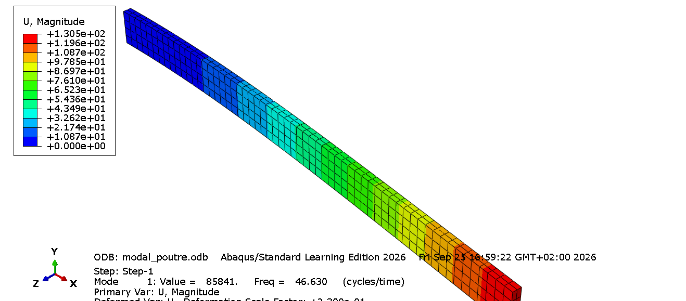
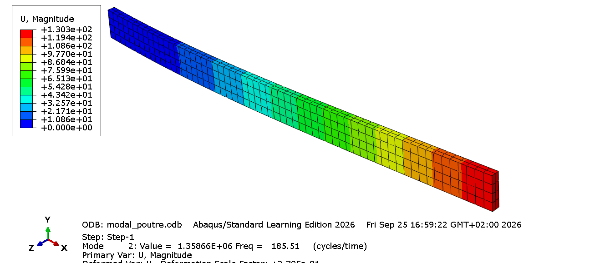
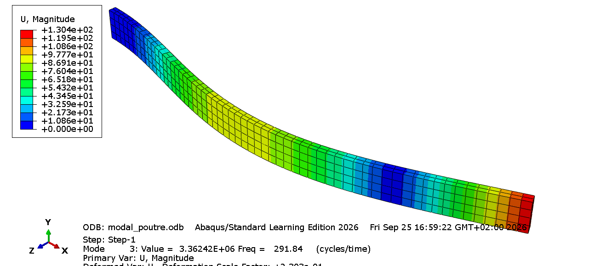
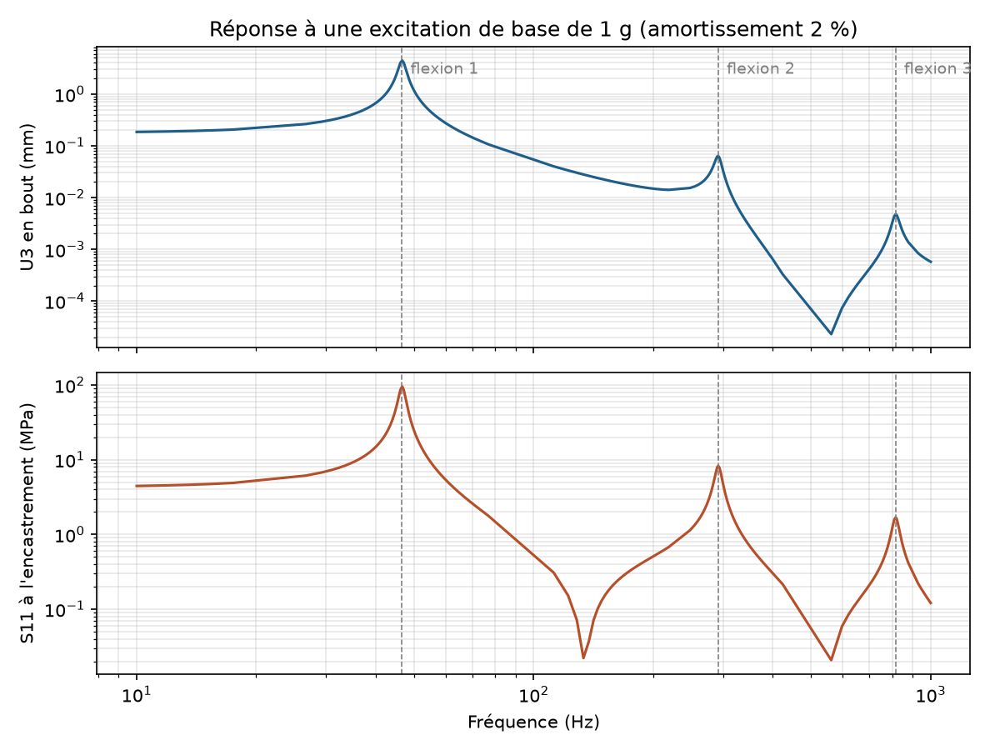
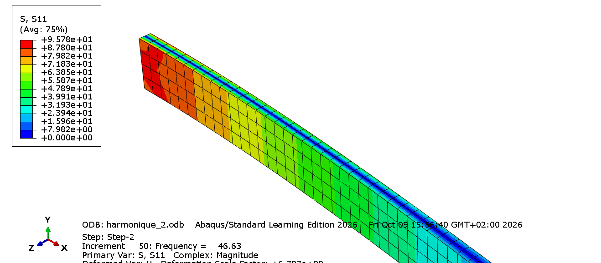
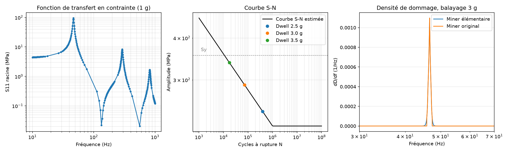

# Analyse vibratoire et fatigue d'une poutre encastrée — Abaqus + Python

*Projet personnel — septembre / octobre 2026 — Charles San*

## En bref

Chaîne de calcul complète sur une poutre acier encastrée-libre soumise à une excitation vibratoire de base : **analyse modale → réponse harmonique → durée de vie en fatigue**, sous Abaqus avec post-traitement automatisé en Python. Chaque étape est validée par un calcul analytique indépendant.

| Étape | Résultat clé |
|---|---|
| Analyse modale (10 modes) | Écart < 0,5 % sur les modes de flexion faible ; écart croissant en flexion forte expliqué par la limite d'Euler-Bernoulli (effets Timoshenko) |
| Réponse harmonique (1 g, ζ = 2 %) | Déplacement en bout 4,47 mm (−1 %) ; contrainte à 50 mm de l'encastrement 71,3 MPa (−0,1 %) ; +6 % près de l'encastrement, expliqué par un effet 3D (Poisson bloqué) |
| Fatigue (S355, Basquin + Marin) | Vie infinie jusqu'à **2,26 g** à la résonance ; ≈ 1 300 balayages sinus 10–1000 Hz à 3 g (Miner) |
| Sensibilité | L'amortissement est le paramètre dominant : ±10 % sur ζ ⇒ facteur ~2,5 sur la durée de vie |
| Vérification du maillage | Convergé (< 0,5 % de 24 à 480 éléments) ; le type d'élément pèse jusqu'à 40 % sur la contrainte (C3D8 trop raide, C3D8R trop souple) |

## Objectif

Mettre en place une chaîne de calcul complète, de l'analyse modale jusqu'à l'estimation de durée de vie en fatigue :

1. **Analyse modale** (Abaqus) : fréquences et modes propres, validés par l'analytique
2. **Réponse harmonique** (Abaqus) : contraintes en régime établi sous excitation
3. **Post-traitement fatigue** (Python) : extraction ODB, comptage de cycles, cumul de dommage (règle de Miner), courbe S-N

## Cas d'étude

Poutre en acier, encastrée-libre.

| Paramètre | Valeur |
|---|---|
| Longueur L | 300 mm |
| Section b × h | 20 × 5 mm |
| Module d'Young E | 210 000 MPa |
| Coefficient de Poisson ν | 0,3 |
| Masse volumique ρ | 7,85e-9 t/mm³ |
| Masse totale | 2,355e-4 t (235,5 g) |

Système d'unités : **mm / t / s / MPa**.

## 1. Analyse modale

### Références analytiques

**Flexion (Euler-Bernoulli)**

$$f_n = \frac{(\beta_n L)^2}{2\pi} \sqrt{\frac{EI}{\rho A L^4}}$$

avec βL = 1,875 ; 4,694 ; 7,855 ; 10,996 ; 14,137.

**Torsion (Saint-Venant)**

$$f_n = \frac{2n-1}{4L} \sqrt{\frac{GJ}{\rho I_p}}$$

avec J ≈ 0,281·b·h³ (section rectangulaire, b/h = 4) et Iₚ = bh(b² + h²)/12.

Calcul : `python/analytique.py`

### Modèle éléments finis

- Solide 3D extrudé, encastrement sur la face x = 0
- Step *Frequency*, solveur Lanczos, 10 modes extraits
- Maillage **C3D8I** (hexaèdres linéaires à modes incompatibles), 60 × 4 × 2 éléments, soit 480 éléments et 915 nœuds
- Choix du C3D8I : éviter le verrouillage en cisaillement en flexion avec seulement 2 éléments dans l'épaisseur

### Résultats

Les modes sont identifiés à partir des facteurs de participation : composante Z pour la flexion faible, composante Y pour la flexion forte, rotation X seule pour la torsion.

| Mode | Type | Analytique (Hz) | Abaqus (Hz) | Écart |
|---|---|---|---|---|
| 1 | Flexion faible 1 | 46,4 | 46,63 | +0,5 % |
| 2 | Flexion forte 1 | 185,6 | 185,51 | −0,05 % |
| 3 | Flexion faible 2 | 290,9 | 291,84 | +0,3 % |
| 4 | Flexion faible 3 | 814,6 | 815,92 | +0,2 % |
| 5 | Flexion forte 2 | 1 163,5 | 1 139,4 | −2,1 % |
| 6 | Torsion 1 | ~1 190 | 1 163,2 | −2,3 % |
| 7 | Flexion faible 4 | 1 596,1 | 1 595,8 | −0,02 % |
| 8 | Flexion faible 5 | 2 638,5 | 2 631,9 | −0,25 % |
| 9 | Flexion forte 3 | 3 258,2 | 3 095,6 | −5,0 % |
| 10 | Torsion 2 | ~3 570 | 3 494,8 | −2,1 % |

### Analyse

- **Flexion faible** : écart inférieur à 0,5 % sur les 5 modes. Modèle et maillage validés.
- **Flexion forte** : l'écart croît avec le rang du mode (−0,05 % → −2,1 % → −5,0 %). C'est la limite de la théorie d'Euler-Bernoulli, qui néglige le cisaillement transverse et l'inertie de rotation. La hauteur dans le plan de flexion (20 mm) devient non négligeable devant la longueur d'onde des modes élevés, et la poutre se comporte alors selon Timoshenko. Euler-Bernoulli surestime donc les fréquences.
- **Torsion** : écart d'environ 2 %, cohérent avec les approximations de Saint-Venant (coefficient J tabulé, gauchissement bloqué à l'encastrement non pris en compte). Le rapport torsion 2 / torsion 1 vaut 3,00, conforme à la théorie.

### Participation modale

Masse effective cumulée sur les 10 modes, rapportée à la masse totale :

| Direction | Masse effective cumulée | Critère 90 % |
|---|---|---|
| Z (flexion faible) | 91,8 % | ✔ |
| Y (flexion forte) | 86,8 % | ✘ (modes supplémentaires nécessaires) |

Les 100 % ne sont jamais atteints, car la masse des nœuds encastrés ne participe à aucun mode.

| Mode 1 — flexion faible (46,6 Hz) | Mode 2 — flexion forte (185,5 Hz) | Mode 3 — flexion faible (291,8 Hz) |
|---|---|---|
|  |  |  |

**Choix pour la suite : excitation selon Z (flexion faible)**, direction la plus souple et la plus critique. Les 10 modes extraits sont suffisants dans cette direction.

## 2. Réponse harmonique

### Paramètres

- Step *Steady-state dynamics, Modal*, basé sur les 10 modes extraits au step *Frequency*
- **Excitation de base** en accélération selon Z : 1 g (9 810 mm/s²), amplitude constante sur 10 – 1 000 Hz
- **Amortissement modal** : 2 % critique sur tous les modes (hypothèse)
- Points de calcul resserrés autour des fréquences propres
- Post-traitement en module complexe (*Magnitude*)

### Référence analytique (mode 1)

Amplitude modale à la résonance, puis déplacement et contrainte en peau :

$$q_1 = \frac{\Gamma_1 \, a_0}{2\zeta\,\omega_1^2}, \qquad \Gamma_1 = \sqrt{M}\,\frac{2\sigma_1}{\beta_1 L}$$

avec σ₁ = 0,7341. Le Γ₁ analytique (0,0120) est identique au facteur de participation Abaqus.

### Résultats au pic du mode 1 (~46,6 Hz)

| Grandeur | Point | Analytique | Abaqus | Écart |
|---|---|---|---|---|
| U3 (déplacement relatif) | Bout libre (300, 10, 2,5) | 4,52 mm | 4,47 mm | −1,1 % |
| S11 | Face sup., x = 5 mm (5, 10, 5) | 90,5 MPa | 96,0 MPa | +6,1 % |
| S11 | Face sup., x = 50 mm (50, 10, 5) | 71,4 MPa | 71,3 MPa | −0,1 % |

### Analyse

- **Réponse en fréquence** : seuls les modes de flexion faible (≈ 47, 292 et 816 Hz) répondent à une excitation en Z. En déplacement, les pics décroissent en 1/ω² : le mode 1 domine d'un facteur ~70 sur le mode 2 et ~1 000 sur le mode 3 (échelle log nécessaire pour les visualiser). En contrainte, l'écart se resserre car la courbure croît en β².
- **Déplacement** : écart de −1 %, principalement dû à la fréquence propre EF légèrement plus élevée (46,63 contre 46,4 Hz), la réponse variant en 1/ω².
- **Contrainte loin de l'encastrement** (x = 50 mm) : −0,1 %, accord parfait avec la théorie des poutres.
- **Contrainte près de l'encastrement** (x = 5 mm) : +6 %. Effet 3D local : l'encastrement bloque la contraction latérale par effet Poisson, ce qui génère une contrainte transverse σ_yy ≈ ν·σ_xx et augmente σ_xx (jusqu'à un facteur 1/(1−ν²) ≈ 1,10 à l'encastrement). La théorie des poutres ignore cet effet.

### Points de vigilance

- **Singularité** : les nœuds situés exactement sur la face encastrée (x = 0) donnent des contraintes non physiques. Lecture à x = 5 mm.
- **Lecture en peau** : avec 2 éléments dans l'épaisseur, les valeurs aux points d'intégration de l'élément supérieur sont à mi-distance de la fibre neutre, soit environ la moitié de la contrainte en peau. Lecture en valeurs nodales extrapolées sur la face supérieure.





**Contrainte retenue pour la fatigue : 96 MPa** (valeur EF en zone d'encastrement, 1 g, ζ = 2 %).

## 3. Fatigue

Scripts : `python/extract_odb.py` (extraction ODB → `reponse_1g.csv`) puis `python/fatigue.py`.

### Extraction automatisée

Le script lit l'ODB du step harmonique (50 points par intervalle) et extrait, pour chaque fréquence, le module complexe de S11 au nœud RACINE (moyenné sur les éléments adjacents) et de U3 au nœud BOUT. Pic S11 extrait : **95,8 MPa à 46,63 Hz**, identique à la lecture manuelle.

### Courbe S-N estimée

Acier S355 : Su = 510 MPa, Sy = 355 MPa. Méthode de Shigley :

| Paramètre | Valeur |
|---|---|
| S à 10³ cycles (0,9 Su, flexion) | 459 MPa |
| Facteur de surface ka (usiné) | 0,864 |
| Facteur d'échelle kb (d_eq = 8,1 mm) | 0,992 |
| Limite d'endurance Se = ka·kb·0,5·Su (10⁶ cycles) | **219 MPa** |
| Basquin S = a·N^b | a = 964 MPa, b = −0,107 |

### Contrainte moyenne

Poids propre : σm = 4,2 MPa à l'encastrement. Correction de Goodman σa,eq = σa / (1 − σm/Su) : **+0,8 %**, négligeable. La sollicitation est quasi alternée pure.

### Cas 1 : excitation entretenue à la résonance (46,6 Hz)

| Niveau | σa équivalente | N (cycles) | Durée de vie |
|---|---|---|---|
| 1 g | 97 MPa | ∞ | infinie |
| 2 g | 193 MPa | ∞ | infinie |
| 2,5 g | 241 MPa | 4,0·10⁵ | 2 h 20 |
| 3 g | 290 MPa | 7,3·10⁴ | 26 min |
| 3,5 g | 338 MPa | 1,7·10⁴ | 6 min |

- **Seuil de vie infinie : 2,26 g**
- **Début de plastification : 3,71 g**. Au-delà, le calcul linéaire n'est plus valide.

### Cas 2 : balayage sinus 10 → 1 000 Hz (essai de qualification)

Balayage logarithmique à 1 octave/min (6,6 min par balayage), niveau 3 g. Cumul de dommage de Miner, D = Σ nᵢ/Nᵢ :

$$D = \int_{f_0}^{f_1} \frac{60}{\ln 2 \cdot R} \, \frac{df}{N(\sigma(f))}$$

Le nombre de cycles par Hz est constant pour un balayage log.

| Hypothèse | Dommage par balayage | Balayages à rupture |
|---|---|---|
| Miner original (pas de dommage sous Se) | 7,7·10⁻⁴ | ≈ 1 300 (≈ 140 h) |
| Miner élémentaire (Basquin prolongé sous Se) | 8,1·10⁻⁴ | ≈ 1 240 |

Les deux hypothèses donnent un résultat proche, car tout le dommage se concentre dans la bande de demi-puissance du mode 1 (≈ 2ζf ≈ 1,9 Hz, soit ~160 cycles par balayage), où σ > Se.

### Sensibilité à l'amortissement (résonance, 3 g)

| ζ | σa | Durée de vie |
|---|---|---|
| 1 % | 579 MPa | hors domaine (σ > Sy) |
| 2 % | 290 MPa | 26 min |
| 3 % | 193 MPa | infinie |
| 5 % | 116 MPa | infinie |

À la résonance, σ ∝ 1/ζ et N ∝ σ^(1/b) ≈ σ⁻⁹,³. Une incertitude de 10 % sur ζ modifie donc la durée de vie d'un facteur ~2,5. **L'amortissement est le paramètre le plus influent** et devrait être recalé par essai (mesure de la bande de demi-puissance).

### Limites

- Courbe S-N estimée et non mesurée (dispersion typique d'un facteur 3 à 10 sur N)
- Pas de concentration de contrainte (Kt) ni d'effet d'entaille à l'encastrement réel
- Amortissement supposé (2 %)
- Calcul linéaire : valide uniquement sous Sy et en petits déplacements



## 4. Vérification du maillage

Script : `python/convergence.py` (lancé depuis Abaqus/CAE). Il génère les fichiers d'entrée de chaque maillage, lance les calculs (step *Frequency* puis *Steady-state dynamics* entre 30 et 70 Hz) et compare trois grandeurs à l'analytique : f₁, U3 en bout au pic et S11 en peau à x = 50 mm.

- **Convergence** : 4 maillages C3D8I de 78 à 915 nœuds (limite de 1 000 nœuds de la Learning Edition)
- **Type d'élément** à maillage identique (60 × 4 × 2) : C3D8I, C3D8 (intégration complète, sensible au verrouillage en cisaillement) et C3D8R (intégration réduite, contrôle d'hourglass)

Les maillages sont choisis pour qu'un nœud existe toujours exactement en (50, 10, 5) et en (300, 10, 0).

### Résultats

| Maillage | Élément | Nœuds | f₁ (Hz) | Écart | U3 bout (mm) | Écart | S11 x = 50 (MPa) | Écart |
|---|---|---|---|---|---|---|---|---|
| 12×2×1 | C3D8I | 78 | 46,64 | +0,5 % | 4,45 | −1,5 % | 71,2 | −0,2 % |
| 30×2×1 | C3D8I | 186 | 46,59 | +0,4 % | 4,48 | −0,9 % | 71,3 | −0,1 % |
| 48×4×2 | C3D8I | 735 | 46,65 | +0,5 % | 4,47 | −1,1 % | 71,3 | −0,1 % |
| **60×4×2** | **C3D8I** | **915** | **46,63** | **+0,5 %** | **4,47** | **−1,0 %** | **71,3** | **−0,1 %** |
| 60×4×2 | C3D8 | 915 | 53,22 | +14,7 % | 3,43 | −24,0 % | 43,6 | −39,0 % |
| 60×4×2 | C3D8R | 915 | 40,40 | −12,9 % | 5,96 | +31,8 % | 47,4 | −33,6 % |
| Analytique | — | — | 46,40 | — | 4,52 | — | 71,4 | — |

### Analyse

- **Convergence (C3D8I)** : les trois grandeurs varient de moins de 0,5 % entre 24 et 480 éléments. Le maillage retenu (60×4×2) est convergé. Les modes incompatibles du C3D8I reproduisent correctement la flexion, même avec un seul élément dans l'épaisseur.
- **C3D8 (intégration complète)** : modèle trop raide (+15 % sur f₁, −24 % sur le déplacement). Un hexaèdre linéaire ne peut pas courber ses arêtes ; en flexion, il développe un cisaillement parasite qui rigidifie artificiellement la structure (**verrouillage en cisaillement**).
- **C3D8R (intégration réduite)** : modèle trop souple (−13 % sur f₁, +32 % sur le déplacement), car certains modes de déformation à énergie nulle (**hourglass**) ne sont pas vus par l'unique point d'intégration. La contrainte de surface est sous-estimée de 34 % : avec 2 éléments dans l'épaisseur, le point d'intégration est à mi-distance de la fibre neutre (≈ 50 % de la contrainte de peau), multiplié par la courbure excessive (×1,32), soit ≈ 0,66.
- **Conclusion** : à maillage égal, le choix de l'élément modifie la fréquence de ±15 % et la contrainte de près de 40 %, alors que le raffinement du maillage a un effet inférieur à 0,5 %. En fatigue, un C3D8R sous-estimerait le dommage de façon non conservative.

## Reproduire les résultats

1. `python/analytique.py` : références analytiques (Python standard)
2. Abaqus/CAE : ouvrir `abaqus/harmonique.cae`, lancer les jobs `modal_poutre` et `harmonique_2`
3. Abaqus/CAE, *File → Run Script* : `python/extract_odb.py` → `python/reponse_1g.csv`
4. `python/fatigue.py` : courbe S-N, durée de vie, Miner, figure `fatigue.png`
5. Abaqus/CAE, *File → Run Script* : `python/convergence.py` → étude de maillage
6. `python/figures.py` : courbe de réponse en fréquence → `images/reponse_frequence.png`

## Organisation du dépôt

```
vibro_fatigue/
├── abaqus/          modèles .cae et .inp, résultats .dat (les .odb ne sont pas versionnés)
│   └── convergence/ fichiers générés par l'étude de maillage
├── python/          analytique.py, extract_odb.py, fatigue.py, convergence.py, figures.py, reponse_1g.csv, fatigue.png
├── images/          captures Abaqus
└── README.md
```

## Avancement

- [x] Calcul analytique des fréquences propres
- [x] Analyse modale Abaqus et comparaison
- [x] Facteurs de participation et masses effectives
- [x] Réponse harmonique (*Steady-state dynamics*), excitation en Z
- [x] Validation analytique de la réponse au mode 1 (déplacement et contrainte)
- [x] Extraction ODB automatisée (Python)
- [x] Post-traitement fatigue : courbe S-N, Goodman, règle de Miner
- [x] Sensibilité au niveau d'excitation et à l'amortissement
- [x] Vérification du maillage et du type d'élément
- [x] Synthèse et visualisations

## Outils

Abaqus Learning Edition 2026 (CAE, scripting Python / odbAccess, fichiers .inp) · Python 3 (numpy, matplotlib) · VSCode · Git